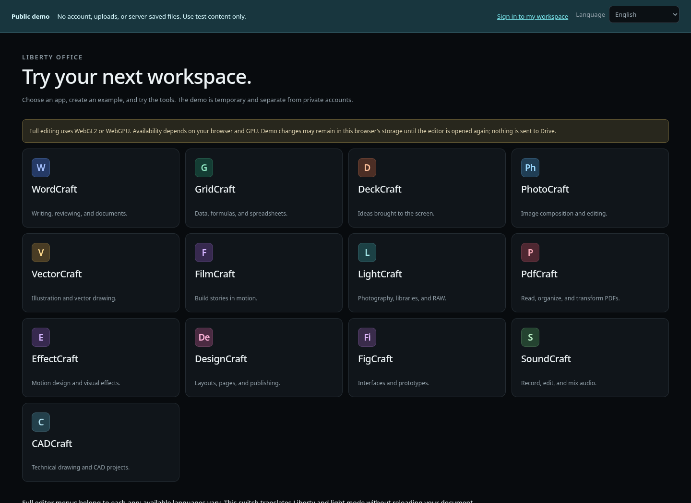
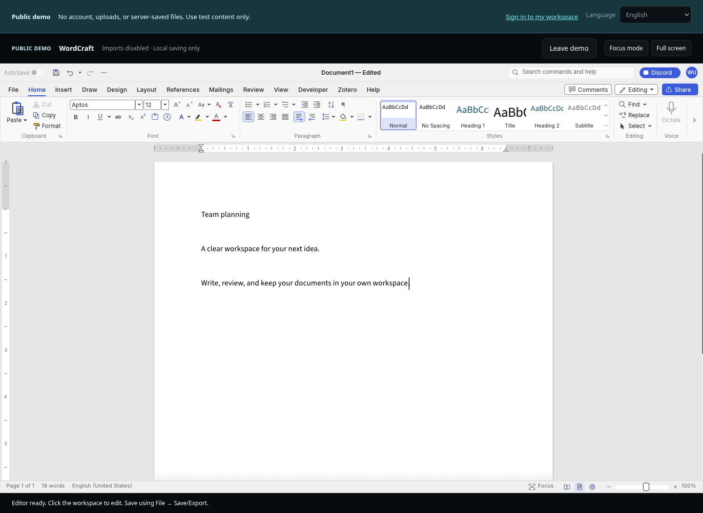
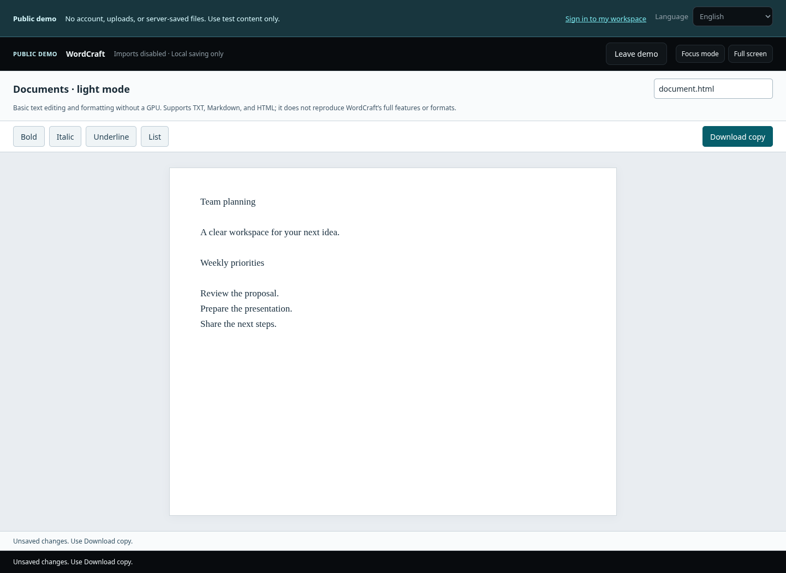
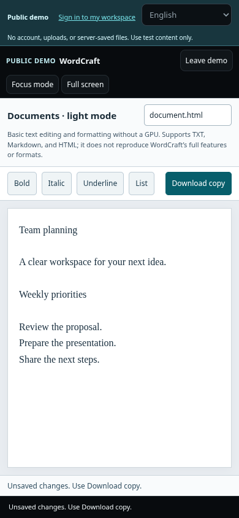

# Liberty Office

Liberty Office is a self-hosted web portal with 13 integrated editors, a private file drive, account administration, and mandatory TOTP multi-factor authentication. English is the default interface and documentation language; Brazilian Portuguese is available in the language selector. [Documentação em português](README.pt-BR.md).

Visit [office.securityops.co](https://office.securityops.co) or [try the demo](https://office.securityops.co/demo). The [Brazilian domain](https://office.securityops.com.br) redirects to the primary origin.

## Try it without an account

The public demo has a permanent demo notice, disables uploads and runs editors on a separate origin from private workspaces. It cannot write to your Drive. Editing is temporary; export a local copy if you need to keep an experiment.

The lightweight text mode works without WebGL and supports basic writing and formatting. It does not provide full DOCX fidelity. Full graphical editors require working WebGL2 or WebGPU support in the browser. Startup errors are displayed explicitly, with a compatible option when one exists.

In lightweight mode, TXT and Markdown are plain text: visual formatting is not
exported. Use HTML to export basic formatting. Imported HTML is converted to
inert text while preserving line and block boundaries; it is never executed.

Native editing and small-screen layout

## Run it yourself

Linux with Docker Engine and Compose v2 is required. Copy `.env.example` to `.env`, set three distinct HTTPS origins (`PUBLIC_ORIGIN`, `EDITOR_ORIGIN`, `DEMO_EDITOR_ORIGIN`), then run `docker compose up -d --build`. The first build downloads pinned upstream editor archives and checks their sizes and SHA-256 hashes. The portal, private editors and demo editors use host ports 8097, 8098 and 8099, all bound to loopback by default. Place an HTTPS reverse proxy in front of them. See [operations in English](docs/OPERATIONS.md) or [Portuguese](docs/OPERATIONS.pt-BR.md) for proxy settings, backup, restore, and upgrades.

FigCraft and GridCraft are rebuilt from pinned Rust sources with browser file-I/O and initial cell-input fixes, respectively. The other editors use verified upstream bundles with the documented branding preparation. Source builds currently require Linux x86-64 and additional time and disk space for Rust dependencies, but no server GPU. Original file encoders and licenses are preserved; see [the source-build details](docs/LICENSING.md#source-built-editors).

The first administrator is created with a one-time bootstrap token stored in the persistent volume. Run `./libertyctl token` on the host to retrieve it privately. There is no default password or public registration. Complete TOTP enrollment and save the recovery codes before using files or editors.

## Data and limits

Keep the database, file blobs, MFA key, and bootstrap state in one persistent volume. Run one application instance and one worker per volume; the database uses SQLite WAL on local storage. Back up and test a restore before upgrades. The server can read stored files: this is not end-to-end encryption. Editor compatibility depends on each upstream web application and the browser; there is no universal autosave or live collaboration guarantee.

The Liberty source is AGPL-3.0-or-later and is offered at `/source.zip`. Upstream editors retain their own licenses and notices under `licenses/upstream/`; see [licensing and integration conditions](docs/LICENSING.md). The project is not affiliated with Microsoft, Adobe, or Artcraft.

## Development and validation

Source integrity is recorded with SecOps CodeMark. See [verification instructions](docs/INTEGRITY.md); private signing keys are never distributed.

Use Python 3.12+, install `requirements-dev.txt` with `pip install --require-hashes`, and run `python -m pytest -q`. JavaScript tests run with `npm ci` and `npm test`. Browser acceptance uses isolated synthetic data; see [acceptance criteria](docs/ACCEPTANCE.md). The release remains a candidate: verify the formats and editors you depend on before using important files.
