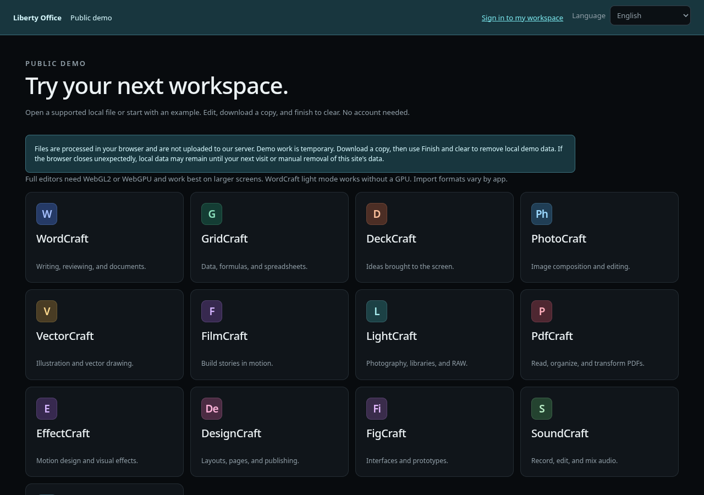
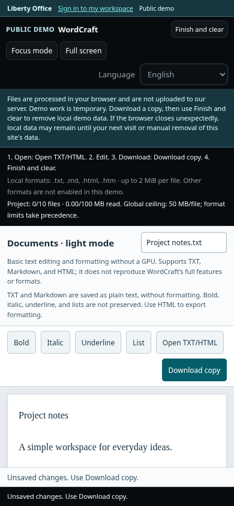

# Liberty Office

Portal web self-hosted com 13 editores integrados, Drive privado, administração de contas e MFA obrigatório. Inglês é o idioma padrão; selecione português brasileiro na interface. **Versão 0.2.0-rc.2.**

**Acessar:** [office.securityops.co](https://office.securityops.co) · [office.securityops.com.br](https://office.securityops.com.br) · [Experimentar a demonstração](https://office.securityops.co/demo). [English documentation](README.md).



A demonstração processa arquivos compatíveis no navegador, sem enviar documentos
ao servidor. Usa uma origem separada dos editores privados e não grava no Drive.
Baixe uma cópia e escolha **Concluir e limpar**. Se o navegador fechar
inesperadamente, dados locais podem permanecer até a próxima visita ou a remoção
dos dados do site da demo. Feche abas de demos antigas antes de iniciar uma
sessão atualizada.

Importações locais aceitam TXT no WordCraft, CSV/TSV no GridCraft, roteiros
TXT/Markdown no DeckCraft e TXT/Markdown/HTML no modo leve. Esses formatos têm
**limite de entrada de 2 MiB**, além dos limites de conteúdo decodificado. Os
tetos gerais são 50 MB por arquivo e 10 arquivos/100 MB cumulativos por projeto;
prevalecem os limites menores do formato. Substituir um arquivo não reinicia o
consumo. Outros editores oferecem exemplos ou ferramentas de criação, mas suas
importações locais continuam bloqueadas até qualificar limites dos parsers.
Veja os [limites de operação da demo](docs/OPERATIONS.pt-BR.md#demonstração-pública).
O modo leve permite escrever sem WebGL; não oferece a fidelidade DOCX completa.

Com suporte gráfico disponível, o WordCraft abre seu editor completo original.
Se faltar suporte, o Liberty mostra orientações e **Tentar editor completo**,
sem substituir o aplicativo silenciosamente. **Abrir editor básico de texto**
é uma escolha explícita para TXT/Markdown/HTML, não um editor DOCX. Os outros
aplicativos nunca são substituídos por esse editor de texto. No Chrome/Chromium,
confira a aceleração gráfica em Configurações → Sistema e o diagnóstico em
`chrome://gpu`. Dois navegadores podem compartilhar o mesmo driver com defeito;
trocar de navegador pode não resolver. O site não pode habilitar suporte gráfico
bloqueado nem reparar o driver. Não desative o sandbox ou a segurança do navegador.
Erros de carregamento/rede são separados de falhas gráficas reconhecidas.

No modo leve, TXT e Markdown são texto puro e não preservam a formatação visual.
Use HTML para exportar formatação básica. HTML importado vira texto inerte,
preservando quebras e limites de blocos; seu conteúdo nunca é executado.

<details><summary>Edição nativa e tela pequena</summary>




</details>

## Deploy com Docker

O build de fonte atual requer Linux x86-64.

Use Docker Engine com Compose v2 em Linux. O primeiro build baixa releases verificadas por tamanho e SHA-256 e recompila WordCraft, FigCraft e GridCraft dos fontes Rust fixados. As correções preservam texto antes de salvar imediatamente e ao voltar dos controles da faixa de opções, oferecem abrir/salvar no navegador e mantêm a entrada inicial de células, respectivamente. Os demais editores usam bundles upstream verificados com a preparação de marca documentada. Reserve tempo e disco adicionais para Rust; testes nativos do WordCraft usam Vulkan por CPU, sem GPU no servidor. Não há download de código no startup. Encoders e licenças originais são preservados; veja [os detalhes do build](docs/LICENSING.md#source-built-editors). O navegador desktop atualizado precisa de WebAssembly/WebGL; funções avançadas de áudio/vídeo dependem das capacidades do navegador.

O modo leve do WordCraft não baixa JS/WASM nativo. O modo completo baixa um
módulo de aproximadamente 17 MiB gzip na primeira utilização, com as fontes
upstream preservadas. O código público é cacheado separadamente do HTML de
sessão com no-store. Isso não torna toda abertura nativa fria mais rápida nem
comprova fidelidade de documentos complexos.

Extraia o pacote, entre na pasta e execute:

```sh
./libertyctl up
./libertyctl token
```

Abra **http://localhost:8097**. O editor privado usa **http://localhost:8098** e os editores da demonstração usam **http://localhost:8099**, em origens separadas. O token inicial é aleatório e fica no volume; não existe senha padrão. Crie o administrador, cadastre seu autenticador TOTP e guarde os dez códigos de recuperação. Arquivos e aplicativos ficam bloqueados até confirmar MFA.

As três portas são publicadas em loopback por padrão. Configure as origens e portas no `.env` ao usar portas diferentes. O comando equivalente sem launcher é `docker compose up -d --build`.

## Domínio e HTTPS

Defina **três origens distintas** no `.env` antes de abrir o cadastro ou criar convites:

```sh
PUBLIC_ORIGIN=https://office.seu-dominio.com
EDITOR_ORIGIN=https://edit.office.seu-dominio.com
DEMO_EDITOR_ORIGIN=https://demo-edit.office.seu-dominio.com
```

Com Nginx Proxy Manager em Docker na rede existente `npm-bridge`:

```sh
docker compose -f compose.yaml -f deploy/compose.npm.yaml up -d --build
```

Crie três Proxy Hosts no NPM:

| Origem pública | Encaminhamento |
| --- | --- |
| `office.seu-dominio.com` | `http://liberty-office:8097` |
| `edit.office.seu-dominio.com` | `http://liberty-office:8097` |
| `demo-edit.office.seu-dominio.com` | `http://liberty-office:8097`, apenas GET/HEAD |

Todos devem ter TLS, Force SSL e preservar o cabeçalho `Host` original. O backend decide por esse cabeçalho quais recursos permitir. As origens dos editores não disponibilizam API de usuários, arquivos ou sessão. O portal não serve os bundles de edição. HTTPS é obrigatório fora de localhost, e subpastas como `/office` não são suportadas.

Para outra rede, configure `NPM_NETWORK`. Ao operar com overrides, preserve `COMPOSE_FILE=compose.yaml:deploy/compose.npm.yaml` em todos os comandos do launcher. Veja [operação](docs/OPERATIONS.pt-BR.md) para limites de proxy e armazenamento.

## Aplicativos incluídos


| Aplicativo | Uso | Release fixada |
| --- | --- | --- |
| WordCraft | Documentos e escrita | 0.7.0 |
| GridCraft | Planilhas e dados | 0.7.0 |
| DeckCraft | Apresentações | 0.7.0 |
| PdfCraft | Leitura e organização de PDFs | 0.8.0 |
| PhotoCraft | Edição de imagens | 0.9.0 |
| VectorCraft | Ilustração vetorial | 0.12.0 |
| LightCraft | Fotografia e RAW | 0.8.0 |
| FilmCraft | Edição de vídeo | 0.8.0 |
| EffectCraft | Motion design e efeitos | 0.10.0 |
| DesignCraft | Layout e publicação | 0.8.0 |
| FigCraft | Interfaces e protótipos | 0.6.0 |
| SoundCraft | Áudio | 0.7.0 |
| CADCraft | Desenho técnico | 0.7.0 |

Todos são os editores upstream reais. O Liberty não simula suas funções. A disponibilidade dos pacotes web foi verificada, inclusive a do FilmCraft, que ainda não era indicada na página geral do catálogo. Os aplicativos permanecem em evolução e não têm promessa de equivalência completa com Microsoft ou Adobe.

## Drive e edição

1. Envie um arquivo ao Drive ou abra um aplicativo para criar um projeto.
2. Clique no arquivo e escolha o aplicativo. Na barra do Liberty, **Carregar do Drive** oferece o conteúdo ao editor; dentro dele escolha **Arquivo → Abrir**.
3. Use **Arquivo → Salvar/Exportar** e confira **Salvo no Drive**. Uma exportação com o mesmo nome do arquivo próprio aberto cria uma revisão, com proteção ETag contra alterações concorrentes. Outro formato/nome cria outro arquivo.
4. Se o editor usar um mecanismo incompatível com o adaptador, baixe o original e use o seletor do aplicativo. **Enviar exportação ao Drive** oferece o caminho manual de volta.

O adaptador usa um canal privado entre origens. O editor recebe o arquivo escolhido e um protocolo limitado de exportação; cookies, CSRF e decisões sobre proprietário/ETag ficam no portal. Uma exportação de arquivo compartilhado cria uma cópia da pessoa que editou. Não há autosave universal ou colaboração centralizada.

Se a sessão expirar, preserve a exportação, entre na **mesma conta** em outra aba e use **Reconectar** para repetir o salvamento. Isso não recarrega o documento. Recarregar a página do editor pode perder alterações que ainda não foram exportadas. O estado local do aplicativo no navegador não equivale a arquivo persistido no Drive.

## Contas e armazenamento

O cadastro público permite que qualquer pessoa crie uma conta gratuitamente,
sem convite. Escolha **Criar conta gratuita**, informe nome, usuário e uma senha
de 14–256 caracteres, ative um autenticador TOTP e guarde os códigos de
recuperação. MFA é obrigatório; uma conta incompleta não abre arquivos nem
editores privados.

Cada conta pública começa com **100 MB = 100.000.000 bytes**. Arquivos salvos,
versões, lixeira e envios reservados ocupam essa cota. Downloads continuam
disponíveis quando ela está cheia; exclua versões desnecessárias ou esvazie a
lixeira para liberar espaço. Arquivos da conta permanecem até sua exclusão e
**não** entram na limpeza da demo. Somente cadastros públicos nunca ativados,
sem arquivos nem outras referências protegidas, podem expirar após 24 horas.
A limpeza ocorre durante cadastros posteriores, não em um prazo exato de
exclusão.

Em instalações próprias, `PUBLIC_SIGNUP_ENABLED` começa em `false` por
compatibilidade com atualizações. Após o operador concluir MFA e qualificar
armazenamento e proxy, defina `true` para abrir o cadastro. A cota pública
`PUBLIC_SIGNUP_QUOTA_BYTES=100000000` é separada de `DEFAULT_QUOTA_BYTES`, usada
nas contas criadas pela administração. Os limites padrão contra abuso são
5 tentativas por origem e 20 cadastros bem-sucedidos globais por hora, com
400 vagas de contas públicas. São proteções de capacidade, não exigências de
convite ou pagamento. Ajuste `SIGNUP_*` apenas conforme a capacidade validada.
Deixe `TRUSTED_PROXY_CIDRS` vazio salvo se os proxies exatos tiverem sido
verificados; não confie em cabeçalhos de encaminhamento arbitrários.

Em **Administração**, também é possível criar contas por convite de uso único,
válido por 48 horas. O painel permite reemitir convites, gerar recuperação de
senha, alterar papel/cota e desativar/reativar contas. A recuperação de senha
conserva o MFA existente; se o cadastro estava incompleto, reinicia a ativação
obrigatória. Não existe opção de desligar MFA.

Em **Minha conta**, altere a senha e revogue sessões de outros dispositivos. Ações sensíveis exigem autenticação recente por senha e um novo TOTP. Desativação e mudança de papel revogam sessões, preservando os documentos.

O Drive oferece pastas, upload/download, renomeação, movimentação, pesquisa, compartilhamento interno de leitura, histórico privado, restauração de revisão como uma nova versão, lixeira e exclusão definitiva. Revisões antigas podem ser excluídas individualmente; a revisão atual fica protegida. Lixeira e todas as revisões ocupam cota até a exclusão.

| Configuração | Padrão | Uso |
| --- | --- | --- |
| `PUBLIC_ORIGIN` | `http://localhost:8097` | Origem exata do portal |
| `EDITOR_ORIGIN` | `http://localhost:8098` | Origem isolada dos editores |
| `DEMO_EDITOR_ORIGIN` | `http://localhost:8099` | Origem isolada da demonstração |
| `LIBERTY_PORT` / `EDITOR_PORT` / `DEMO_EDITOR_PORT` | 8097 / 8098 / 8099 | Portas publicadas no host |
| `LIBERTY_BIND` | `127.0.0.1` | Interface de publicação |
| `GLOBAL_QUOTA_BYTES` | 50 GiB | Blobs, revisões, lixeira e reservas de envio |
| `DEFAULT_QUOTA_BYTES` | 5 GiB | Cota inicial de contas criadas pela administração |
| `PUBLIC_SIGNUP_ENABLED` | `false` | Abrir cadastro público após concluir o setup |
| `PUBLIC_SIGNUP_QUOTA_BYTES` | 100.000.000 bytes | Cota inicial das contas públicas gratuitas |
| `SIGNUP_ATTEMPTS` / `SIGNUP_SUCCESSES` | 5 / 20 | Tentativas por origem / sucessos globais por janela |
| `SIGNUP_WINDOW_SECONDS` | 3600 | Janela dos limites de cadastro |
| `SIGNUP_SLOTS` | 400 | Máximo de contas públicas pendentes e estabelecidas |
| `SIGNUP_PENDING_TTL_SECONDS` | 86400 | Idade mínima para limpar cadastro nunca ativado |
| `TRUSTED_PROXY_CIDRS` | vazio | Somente proxies exatos e verificados |
| `MAX_UPLOAD_BYTES` | 100 MiB | Máximo por upload/exportação |
| `LIBERTY_VOLUME_NAME` | `liberty_office_data` | Volume persistente |

Cotas são aplicadas no backend sob transação, inclusive em uploads simultâneos. O limite global não limita imagem, banco, logs ou backups. Alterar a cota padrão não altera contas existentes. Cota zero impede novos dados. Após mudar `.env`, use `docker compose up -d` para recriar o serviço sem remover o volume.

Para escolher disco ou diretório, use `deploy/compose.storage.yaml`. Uma instância e um worker por volume são suportados; SQLite WAL exige filesystem local. Não monte o mesmo banco em réplicas.

## Operação

```sh
./libertyctl status
./libertyctl verify
./libertyctl backup /caminho/privado/liberty-backup.tar.gz
./libertyctl recover nome-do-usuario
./libertyctl password-reset nome-do-usuario
```

Backup e recuperação operacional param o serviço e o reiniciam ao final. O backup contém banco, blobs, revisões e chave MFA. `recover` emite um código único para quem ainda conhece a senha e perdeu o autenticador; a pessoa deverá cadastrar novo MFA. `password-reset` emite um link de 30 minutos para redefinir a senha, inclusive do único administrador, conservando a exigência de MFA. Os dois mecanismos revogam sessões existentes. Guarde seus resultados em canal privado.

A chave `mfa.key` deve acompanhar o banco no backup. O startup recusa banco com chave ausente/incompatível. Restauração exige destino vazio, valida integridade SQLite, chaves, referências e hashes dos blobs, e revoga sessões antigas. Procedimento completo em [operações](docs/OPERATIONS.pt-BR.md).

## Verificação da entrega

```sh
python scripts/verify_release.py
python -m venv .venv
.venv/bin/python -m pip install --require-hashes -r requirements-dev.txt
.venv/bin/python -m pytest -q
npm ci
npm test
```

Para homologar Docker e navegador em **dados descartáveis**, em um host Linux com Docker:

```sh
npx playwright install --with-deps chromium
scripts/docker_acceptance.sh
```

Esse gate constrói uma imagem própria de teste e um volume novo, verifica API/MFA, os 13 editores, reinício, integridade dos bundles, canal de exportação no Chromium e backup/restauração em outro volume. O seed sintético de teste é removido ao final. Não usa nem apaga o volume de produção. Há também um workflow de CI, sem publicação automática.

Esta candidata requer homologação com seus documentos em um ambiente separado. Verifique abertura, edição, exportação, reabertura e restauração de backup antes de usar arquivos importantes. Consulte [diagnóstico e aceitação](docs/OPERATIONS.pt-BR.md#diagnóstico-e-aceitação).

## Privacidade e licença

Os documentos ficam no armazenamento do seu servidor, legíveis pelo operador do host. **Não há E2EE equivalente ao CryptPad.** O isolamento por origem protege o portal dos scripts de edição; o navegador ainda mantém dados locais específicos dos aplicativos. Ao trocar a conta, o adaptador limpa Web Storage, IndexedDB, CacheStorage e OPFS antes de executar os motores e interrompe editores anteriores em outras abas. Salve no Drive antes de trocar de conta. Perfis separados de navegador continuam adequados para computadores compartilhados.

A imagem executa sem root, sem Docker socket, com raiz somente leitura, capabilities removidas, healthcheck e logs limitados. Senhas usam Argon2id; TOTP tem proteção contra replay e segredos criptografados por chave persistente. Leia [segurança](docs/SECURITY.pt-BR.md) para as fronteiras do modelo.

Código Liberty: **AGPL-3.0-or-later**, com fonte oferecido em `/source.zip`. O código principal dos editores declara **MIT OR Apache-2.0**, mas dependências, assets e marcas têm termos próprios. Consulte o [inventário e as condições de integração](docs/LICENSING.md), incluindo as substituições das marcas gráficas restritas, e a [verificação CodeMark](docs/INTEGRITY.md). As atribuições originais permanecem em `licenses/upstream/`. Não há afiliação com Microsoft, Adobe ou Artcraft.
